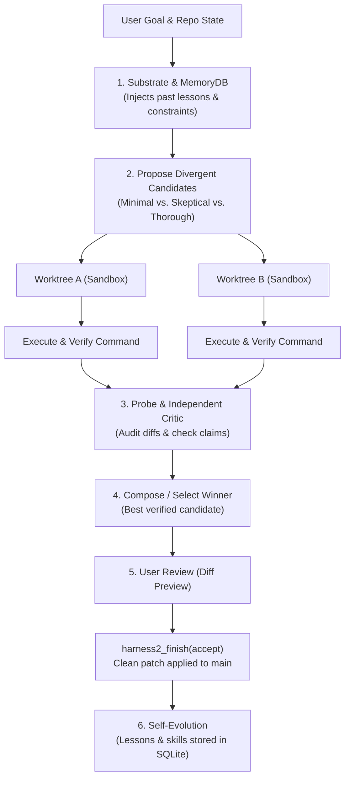

<h3 align="center">
  <br>
  Recursive Agent Harnessing for an Open World
</h3>

<p align="center">
  <a href="https://arxiv.org/pdf/2610.14224"></a>
  <a href="https://harness2.github.io"></a>
  <a href="docs/BENCHMARKS.md"></a>
  <a href="LICENSE"></a>
</p>

<p align="center">
  <a href="docs/BENCHMARKS.md#jobbench">
    
  </a>
</p>

A **harness** is the system around a model that enables it to act as an agent:
prompts, tools, memory, skills, orchestration, and more. **Harnessing** is the
process of optimizing that system.

Harness² is a plug-and-play framework for **recursive agent harnessing** in an
open world, where agents encounter tasks unseen during harness design. It
connects two levels of recursion while keeping model weights fixed:

* **Task-level recursion** refines the execution harness for the current task
  through a contrastive **Propose–Probe–Compose** step: propose edits, probe
  their effects on the same task, and compose a refined harness from behavioral
  contrasts between executions, without ground-truth feedback.
* **Harnessing-level recursion** updates a persistent *improvement harness*
  with adopted harnesses and evidence-supported lessons from each task to guide
  future refinement.

<p align="center">
  <a href="assets/harness2_pipeline.png">
    
  </a>
</p>

Across three professional benchmarks and four model–harness configurations, a
single Harness² step improves GLM-5 and Gemini 3.5 Flash over their base
harnesses, with gains of up to 11.5 points on WorkBuddy-Bench, 4.5 points on
JobBench, and 11.8 percentage points on LAB's partial pass rate. Increasing the
task-level recursion budget brings further gains.

The release supports **parallel and sequential recursion**, **OpenCode and
Codex executors**, and **JobBench, LAB, and WorkBuddy-Bench**.

## Video overview

https://github.com/user-attachments/assets/76b10548-b14b-4c8f-9aa5-a93662df4d56

## Contents

- [Video overview](#video-overview)
- [How Harness² Works](#how-harness-works)
- [Harness components](#harness-components)
- [Install](#install)
- [Docker Deployment](#docker-deployment)
- [General Task Runner (`harness2-general`)](#general-task-runner-harness2-general)
- [Run a benchmark](#run-a-benchmark)
- [Model Context Protocol (MCP) Server](#model-context-protocol-mcp-server)
- [Persistent Memory & Self-Evolution](#persistent-memory--self-evolution)
- [Best Practices & Tips](#best-practices--tips)
- [Experiments](#experiments)
- [Web access](#web-access)
- [Results and resume](#results-and-resume)
- [Citation](#citation)
- [Contributing](#contributing)
- [License](#license)
- [Disclaimer](#disclaimer)

## How Harness² Works

Model weights are frozen, but real software environments are messy, fragile, and dynamic. Rather than allowing an LLM to edit files directly on your active git branch—where syntax errors, broken imports, and hallucinated test passes can corrupt your project—Harness² wraps the LLM in an **isolated, scientific experimentation loop**:



1. **Context & Memory Retrieval:** Pulls past failure modes, architectural guardrails, and project conventions from `.harness2/memory.db`.
2. **Divergent Propose:** Generates competing candidate strategies (`minimal`, `skeptical`, `thorough`) instead of relying on a single guess.
3. **Sandboxed Probing:** Spins up detached, isolated git worktrees (`.harness2/worktrees/`). Your `main` branch and active working directory remain 100% untouched.
4. **Verification Gates:** Runs real test and lint commands inside the sandbox.
5. **Independent Critic:** An adversarial inspection checks whether tests genuinely pass and flags hallucinated claims or placeholder code.
6. **Compose & Self-Evolution:** The winning patch is presented cleanly. Upon acceptance, facts and procedural skills are stored for subsequent tasks.

## Harness components

Harness² exposes eight editable components around the model: **system prompt,
guardrails, memory, tool guidance, subagents, skills, scripts, and plugins**.
They control context construction, the tool interface, delegation, and behavior
inside the tool loop.

<p align="center">
  <a href="assets/components.png">
    
  </a>
</p>

## Install

Use **Linux, Python 3.12, and [uv](https://docs.astral.sh/uv/getting-started/installation/)**.
From the repository root:

```bash
uv venv --python 3.12 .venv
source .venv/bin/activate
uv pip install -e '.[render]'
harness2-demo --output runs/demo --k 2
```

The local demo runs both recursion modes with deterministic editors and real
Python executions. It requires no model credentials.

For model-backed runs, configure your API keys in `.env`:
```bash
cp .env.example .env
```

```bash
# 1. Inception Labs (fast & efficient code reasoning) -- the simplest setup:
#    the solver, the improver and the selector all use it.
export INCEPTION_API_KEY="your-inception-key"

# 2. Any OpenAI-compatible endpoint
export HARNESS2_LLM_BASE_URL="https://api.example.com/v1"
export HARNESS2_LLM_API_KEY="your-key"
export HARNESS2_LLM_MODEL="some-model"

# 3. The OpenCode CLI channel (optional -- the default needs neither of these)
export HARNESS2_SOLVER_MODEL="anthropic/claude-sonnet-4-5"
export HARNESS2_IMPROVER_MODEL="anthropic/claude-sonnet-4-5"
```

Then check the machine can run it:

```bash
harness2-doctor --workspace ~/my-project
```

See [docs/TROUBLESHOOTING.md](docs/TROUBLESHOOTING.md) for what each failure
looks like and what to do about it.

---

## Docker Deployment

Harness² can be run fully containerized to isolate its dependencies and provide reproducible execution:

```bash
# Build the Docker image
docker build -t harness2:latest .

# Run the MCP Server inside Docker over stdio
docker run -i --rm \
  -e INCEPTION_API_KEY="your-key" \
  -v /path/to/your/workspace:/workspace \
  harness2:latest harness2-mcp
```

Or run via `docker-compose`:
```bash
# Run the general harness inside the container
docker compose run --rm --entrypoint harness2-general harness2-mcp \
  --workspace /workspace --goal "..."
```

---

## General Task Runner (`harness2-general`)

No benchmark, no dataset, no judge. Point the engine at any git repository and a goal, and the same Propose-Probe-Compose loop executes:

```bash
harness2-general --workspace ~/my-project \
  --goal "Add exponential backoff retry logic to api/client.py and verify with tests" \
  --verify "pytest tests/test_client.py -q" \
  --k 2 --mode parallel
```

### One API key is enough

The solver, the improver and the selector all run on the same model service by
default. Put your key in `.env` and the whole loop runs:

```bash
cp .env.example .env
echo 'INCEPTION_API_KEY=sk-...' >> .env
harness2-doctor --workspace ~/my-project   # checks this machine can run it
```

`harness2-doctor` is the first thing to run when something does not work: it
checks the provider, git, a real worktree round trip, the sandbox, the state
directory, and tells you what to fix.

### CLI Parameters

| Flag | Default | Description |
|---|---|---|
| `--workspace` | *(required)* | Path to the target git repository. |
| `--goal` | *(required)* | Clear instruction of what the agent should accomplish. |
| `--verify` | `None` | Shell command run inside the worktree to verify candidate correctness (e.g. `pytest -q`, `npm test`). Its **exit status** is the verdict. |
| `--k` | `2` | Recursion budget: $4k$ rollouts and $3k$ improver sessions per mode. |
| `--mode` | `parallel` | `parallel` (probes $k$ candidates and composes the evidence) or `sequential` (successive refinement), or `both`. |
| `--channel` | `http` | How the improver and the selector run. `http` uses the same model service as the solver; `opencode` uses the OpenCode CLI and needs `HARNESS2_IMPROVER_MODEL`. |
| `--runtime` | `http` | How the *rollout's* solver runs. `http` is a model call that writes files; `opencode` is a real agent session under the OpenCode CLI. |
| `--model` | `HARNESS2_SOLVER_MODEL` | The rollout's model, for `--runtime opencode`. |
| `--improver-model` | the provider's model | The proposer's and selector's model. |
| `--timeout` | `1800` | Timeout per candidate execution in seconds. |
| `--progress` | `human` | `human` (a line per stage on stderr), `json` (JSONL), or `none`. |
| `--dry-run` | `False` | Print the budget, the models and where the artifacts will go, and stop. |
| `--no-sandbox` | `False` | Disables Bubblewrap (`bwrap`) isolation if running in environments where unprivileged user namespaces are disabled. |

### The harness reaches the solver

This is the part that makes the loop worth running. The improver's proposal is
not decoration: its text becomes the **operating instructions** the solver
works under, and its scripts are staged into the worktree so they can be run.
A candidate whose harness differs from another's therefore behaves
differently, which is the only reason to run both.

Every candidate records the harness it ran:

```json
{"harness": {"applied": true, "files": 5, "chars": 824, "digest": "999461ed0910"}}
```

### Zero Branch Clutter (Detached Sandboxes)
Harness² runs all candidate probes inside detached git worktrees at `.harness2/worktrees/`. **Zero branches are created in `git branch`**, leaving your active branch and working directory untouched. The worktrees are removed when you accept or discard a session.

### Applying a candidate is guarded

`harness2-finish` reads the candidate's patch before it applies it. A patch
that **deletes files** is refused with the list of what it would remove: a
verification command that exited 0 does not make removing 151 of your files
safe. Pass `--allow-destructive` to apply it anyway.

### Keeping the memory bounded

The harness keeps three kinds of memory under `<workspace>/.harness2/`: the
run artifacts (transcripts and evidence trees), the SQLite record
(sessions, rollouts, facts, lessons), and the experience library (one entry
per task). The first grows fastest — an evidence tree is copied again by the
selection and reflection stages — so it is the one that needs a policy.

Transcripts are stored compressed, the record's large fields are
compressed, library entries a newer entry supersedes are retired, and a
retention policy keeps the recent runs in full while older runs keep their
conclusions and lose their transcripts. The policy runs at the end of every
general run, and can be inspected or applied directly via `harness2_memory_status`.

The retention policy keeps the **selection record** — the file that names the
recommended candidate — and drops the evidence around it. Losing that record
made `harness2-finish` fall back to an arbitrary rollout, and the base
execution is what it picked.

**[docs/FINDINGS.md](docs/FINDINGS.md)** records every bottleneck this
harness hit — the disk blow-up, the isolation escapes, the runtime
mismatches — with the measurement that exposed it, the root cause, and what
was done about it.
**[docs/GENERAL_HARNESS_EXPERIMENTS.md](docs/GENERAL_HARNESS_EXPERIMENTS.md)**
is the working log of the experiments that found them.

---

## Run a benchmark

Harness² supports standardized research benchmarks including **JobBench**, **LAB**, and **WorkBuddy-Bench**:

```bash
# Setup benchmark data and environments
harness2-setup lab
harness2-check --bench lab

# Run benchmark evaluation
harness2 --bench lab --k 1 --mode parallel \
  --only-domains antitrust-competition --max-tasks 1

# Judge and generate report
harness2-judge --bench lab --k 1 --mode parallel
harness2-report --bench lab --k 1 --mode parallel
```

| Benchmark | Tasks | Install | Guide |
|---|---|---|---|
| JobBench | Professional work | `harness2-setup jb` | [JobBench](docs/BENCHMARKS.md#jobbench) |
| LAB | Legal work | `harness2-setup lab` | [LAB](docs/BENCHMARKS.md#lab) |
| WorkBuddy-Bench | Office, web, and code | `harness2-setup wb` | [WorkBuddy](docs/BENCHMARKS.md#workbuddy-bench) |

See [docs/BENCHMARKS.md](docs/BENCHMARKS.md) for full instructions, domain splits, and grading details.

## Model Context Protocol (MCP) Server

Harness² includes an official **MCP Server** (`harness2-mcp`) that exposes recursive agent harnessing capabilities, domain experience library queries, benchmark diagnostics, and harness materialization to external coding agents (**Claude Code**, **OpenCode**, **Codex**, and **Antigravity**).

### Installation & Prerequisites

1. Install the MCP dependencies into your environment:
```bash
uv pip install -e .
uv pip install "mcp>=1.0.0"
```

2. Start or test the server directly over stdio:
```bash
# Via CLI entrypoint
harness2-mcp

# Or via Python module
python -m harness2.mcp_server
```

---

### Client Setup Guides

#### A. OpenCode
Add globally via the OpenCode CLI:
```bash
opencode mcp add --global harness2 -- /absolute/path/to/harness2/.venv/bin/python /absolute/path/to/harness2/harness2/mcp_server.py
```
Or add to `opencode.json` in your project root:
```json
{
  "mcp": {
    "servers": {
      "harness2": {
        "type": "local",
        "command": [
          "/absolute/path/to/harness2/.venv/bin/python",
          "/absolute/path/to/harness2/harness2/mcp_server.py"
        ]
      }
    }
  }
}
```
Verify connection with: `opencode mcp list`.

#### B. Claude Code
Register using Claude's CLI:
```bash
claude mcp add harness2 -- /absolute/path/to/harness2/.venv/bin/python /absolute/path/to/harness2/harness2/mcp_server.py
```
Or add directly to `~/.claude.json`:
```json
{
  "mcpServers": {
    "harness2": {
      "command": "/absolute/path/to/harness2/.venv/bin/python",
      "args": ["/absolute/path/to/harness2/harness2/mcp_server.py"]
    }
  }
}
```

#### C. Codex CLI
Add to `~/.codex/config.json`:
```json
{
  "mcpServers": {
    "harness2": {
      "command": "/absolute/path/to/harness2/.venv/bin/python",
      "args": ["/absolute/path/to/harness2/harness2/mcp_server.py"]
    }
  }
}
```

#### D. Antigravity (`agy`)
Add to `~/.gemini/config/mcp_config.json`:
```json
{
  "mcpServers": {
    "harness2": {
      "command": "/absolute/path/to/harness2/.venv/bin/python",
      "args": ["/absolute/path/to/harness2/harness2/mcp_server.py"],
      "disabled": false
    }
  }
}
```

---

### MCP Tools Reference (11 Exposed Tools)

The Harness² MCP server exposes 11 production-ready tools for IDEs and autonomous agents:

| Tool | Parameters | Description |
|---|---|---|
| `harness2_recursion` | `goal`, `workspace`, `k`, `mode`, `domain`, `verify_cmd`, `timeout`, `sandbox`, `allow_mcp`, `channel`, `improver_model` | **The real Propose–Probe–Compose loop.** An improver proposes harness edits, each candidate is probed in an isolated worktree with that harness as its operating instructions, the contrasts are composed into a refined harness, and a selector picks the winner by reading the candidates — no ground-truth judge required. |
| `harness2_solve` | `goal`, `workspace`, `verify_cmd`, `domain`, `k`, `repair_rounds`, `context_files`, `timeout` | **Main task solver:** Spawns divergent candidate rollouts (`minimal`, `skeptical`, `thorough`) in isolated git worktrees, verifies with tests, audits with an independent critic, and ranks the candidates. Nothing touches your working tree until `harness2_finish(action='accept')`. |
| `harness2_finish` | `session_id`, `workspace`, `action` (`accept` or `discard`), `rollout_label`, `learned_facts`, `keep_worktrees`, `allow_destructive` | **Lifecycle finalizer:** `accept` applies the recommended candidate's diff to your tree and records learned facts; `discard` closes the session and removes the worktrees. A candidate whose diff *deletes files* is refused unless `allow_destructive` is set. |
| `harness2_query_memory` | `workspace`, `category` | **Institutional memory query:** Reads structured facts and lessons from SQLite (`.harness2/memory.db`) and renders them as markdown. |
| `harness2_apply_harness` | `harness_path`, `target_workspace`, `format`, `dry_run`, `backup` | **Harness materialization:** Installs synthesized guardrails and skills into active workspaces with single-pass collision-free merge and `.bak` protection. **Preview by default** — pass `dry_run=false` to apply. |
| `harness2_inspect_library` | `domain`, `runs_dir`, `workspace` | **Experience library reader:** Inspects synthesized domain cues, heuristics, and reusable scripts from `.harness2/library/`. Pass `workspace` to see the general path's library. |
| `harness2_list_sessions` | `workspace`, `status` | **Session auditor:** Lists sessions with their goal, status and chosen winner. |
| `harness2_config_status` | `probe` | **Environment diagnostic:** Reports the provider and model the server will use. `probe=true` makes one live call to confirm the endpoint answers — by default it does not spend anything. |
| `harness2_memory_status` | `workspace`, `prune`, `keep_evidence_runs`, `keep_transcript_runs`, `keep_runs`, `max_age_days` | **Memory policy:** Reports how much disk the harness's memory uses, and optionally applies the retention policy. |
| `harness2_run_demo` | `k`, `mode`, `output_dir` | **Offline verification:** Runs deterministic offline Propose-Probe-Compose recursion without external API calls. |
| `harness2_benchmark_status` | `bench`, `substrate`, `subset` | **Benchmark readiness:** Runs the install checks for one benchmark and reports whether it is ready. WorkBuddy needs a `subset`. |

> `harness2_recursion` is the flagship: it runs the actual recursive loop.
> `harness2_solve` is the cheaper, scripted path — candidates with different
> strategies, but no harness proposal.

---

### Natural Language Examples (Prompts for Your Agent)

Once connected, your coding agent can invoke Harness² tools directly in response to natural language prompts:

#### 1. Safely Solving a Task in an Isolated Sandbox
> *"Implement exponential backoff in `api/client.py` and run tests in an isolated worktree. Show me the diff before touching my repo."*
- Agent calls `harness2_solve(goal="...", workspace=".", verify_cmd="pytest tests/test_client.py")`.
- Candidate rollouts execute in detached worktrees; an independent critic audits changes and verifies the test command.
- Returns the diff and reviewer notes.

#### 2. Reviewing and Accepting the Winner
> *"The diff looks great. Accept rollout probe_1 and save the lessons learned."*
- Agent calls `harness2_finish(session_id="...", action="accept")`.
- Applies the patch cleanly to the active branch, prunes worktrees, and saves facts/skills to SQLite.

#### 3. Querying Past Lessons & Memory
> *"What lessons did Harness² record about our database migrations or API errors?"*
- Agent calls `harness2_query_memory(workspace=".", category="lesson")`.
- Returns categorized heuristics and failure modes encountered in past runs.

---

## Persistent Memory & Self-Evolution

Harness² features a dual-layer institutional memory engine:

1. **SQLite Memory Engine (`.harness2/memory.db`):**
   * **Sessions & Rollouts:** Full record of every candidate approach, strategy tag, and critic audit score.
   * **Facts & Lessons:** Extracted domain facts (`conventions`, `pitfalls`, `architecture`, `commands`).
   * **Component Rendering:** Automatically formats long-term memory into component `c3` (`LongTermMEMORY.md`) so subsequent runs don't repeat mistakes.

2. **Self-Evolution & Procedural Skills (`.harness2/skills/`):**
   * When winning solutions introduce reusable procedures or scripts, Harness² self-evolves by saving modular skill files into `.harness2/skills/`.
   * Those skills are folded into the base harness the **next** run starts from, so a procedure that worked once is available the next time — and it is loaded on demand, not paid for on every run.

---

## Best Practices & Tips

### 1. Slice Tasks Into 1–2 File Deliverables
Language models have bounded output token limits. Asking an LLM to generate 5 complex modules and their tests in a single shot often causes truncated JSON replies (`Unterminated string`).
* **Recommended:** Slice tasks into modular, iterative goals (e.g. Slice 1: Model architecture + unit test; Slice 2: Dataset loader + unit test; Slice 3: CLI integration).

### 2. Choose the Right Recursion Budget ($k$)
* **$k=1$ (Fast):** Generates 1 candidate. Best for small bugfixes or rapid prototyping (~1–2 minutes).
* **$k=2$ (Balanced):** Compares contrasting strategies (`minimal` vs `skeptical`) with independent verification (~3–4 minutes).
* **$k=4$ (Deep):** Comprehensive search for non-trivial architectural problems.

### 3. Watch a run as it goes

A run is tens of minutes of model calls, so `harness2-general` prints a line
per stage and per rollout as it happens. Nothing has to be polled:

```
18:54:46  stage  1/3  dom1   kept-base      0.8s  $0.0000
18:54:52  stage  2/3  inv1   ok             6.6s  $0.0000
18:54:54  rollout 1/4 dom1   delivered      1.9s
18:54:57  stage  3/3  agg1   kept-base      3.1s  $0.0000
```

`--progress json` emits the same events as JSONL, and `--progress none`
silences them. The run also ends with a table of the candidates:

```
candidate      strategy   verify  critic  files    +bytes    -bytes
-------------------------------------------------------------------
agg1           minimal    PASS    10/10       1        27         0
base1          minimal    PASS    10/10       1        27         0
inv1           minimal    PASS    10/10       1        27         0
```

To watch the artifacts of a run that is already going:

```bash
# What is running, and where
watch -n 2 "ls -lt .harness2/runs/ | head -n 10"

# The audit trail: every mission, every reply, every harness that came back
ls .harness2/audit/
```

## Experiments

Scale task-level recursion in two ways: **parallel recursion** explores multiple
candidate harnesses and composes refinements from their execution evidence;
**sequential recursion** carries the refined harness and accumulated evidence
through successive Propose–Probe–Compose steps.

<p align="center">
  <a href="assets/harness2_recursion_modes.png">
    
  </a>
</p>
<p align="center"><em>Parallel recursion explores wider; sequential recursion refines deeper.</em></p>

| Option | Behavior |
|---|---|
| `--k 1` | One Propose–Probe–Compose step |
| `--k K --mode parallel` | Probe `K` general and `K` domain-specific candidates, then produce `K` compositions |
| `--k K --mode sequential` | Refine the harness through `K` successive steps |
| `--substrate cx` | Use Codex instead of the default OpenCode executor |

After each task, harnessing-level recursion retains the adopted harness and
evidence-supported lessons to guide future refinement. See the
[experiment guide](docs/EXPERIMENTS.md) for task selection, concurrency,
reproducibility, and baseline comparisons.

## Web access

Executor network access is unrestricted, and Codex runs with its sandbox
disabled. Public benchmark rubrics may be accessible online. Before evaluation,
configure [network restrictions](docs/EXPERIMENTS.md#web-access) to prevent
access to benchmark answers and grading criteria.

## Results and resume

Results are saved under `runs/`, organized by benchmark and subset where
applicable. They include task summaries, deliverables, adopted harnesses,
reflection notes, and evaluation results.

Repeat the same command to resume. Use a new `HARNESS2_RUNS_DIR` when changing
models or task selection. See [results and resume](docs/EXPERIMENTS.md#results-and-resume)
for details; each command also supports `--help`.

## Citation

```bibtex
@article{xu2026harness2,
  title   = {Harness$^2$: Recursive Agent Harnessing for an Open World},
  author  = {Xu, Ruiyao and Chen, Yanfei and CuiZhu, Zhongying and Dalvi Mishra, Bhavana and Ming, Yifei and Yu, Han and Han, Rujun and Lee, Chen-Yu and Pfister, Tomas},
  journal = {arXiv preprint arXiv:2610.14224},
  year    = {2026},
  url     = {https://arxiv.org/abs/2610.14224}
}
```

## Contributing

See [CONTRIBUTING.md](CONTRIBUTING.md).

## License

Harness² is licensed under [Apache 2.0](LICENSE). Third-party code under
[`third_party/`](third_party/README.md), benchmarks, and datasets retain their
upstream licenses; see
[third-party notices](dependencies/README.md).

## Disclaimer

This is not an officially supported Google product. This project is not eligible
for the [Google Open Source Software Vulnerability Rewards Program](https://bughunters.google.com/open-source-security).
